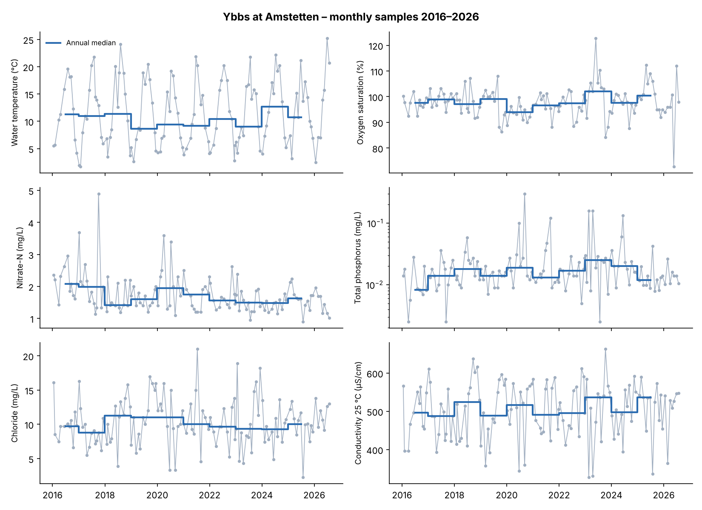
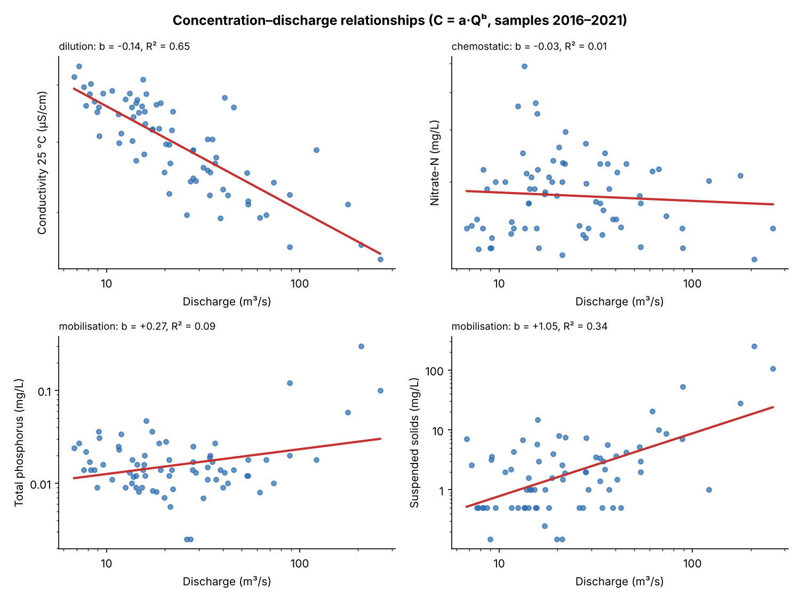
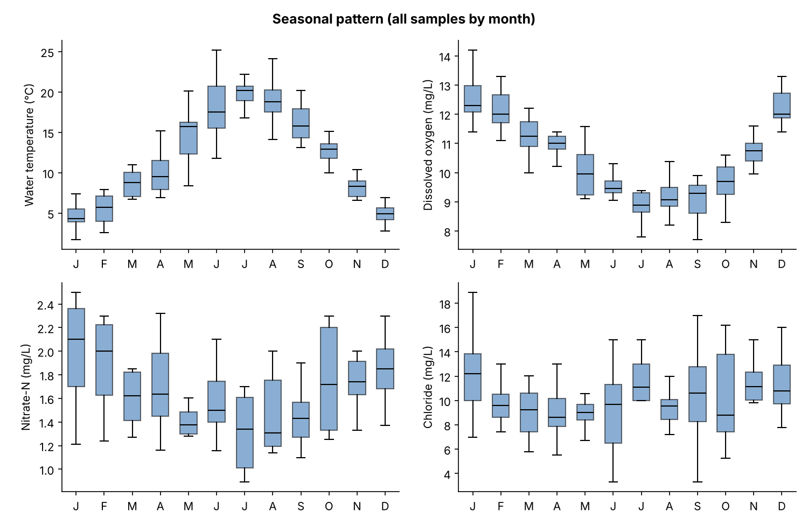
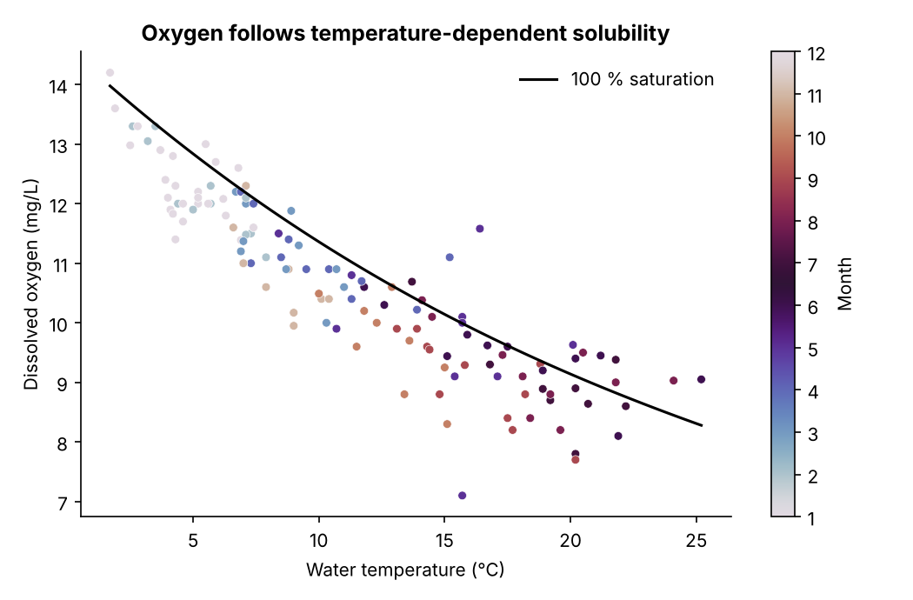

# Water Quality of the Ybbs at Amstetten (Lower Austria)

Analysis of ten years of official river monitoring data (2016–2026) from the
GZÜV monitoring station **Ybbs – Amstetten** (FW30900037), downstream of the
Amstetten wastewater treatment plant. The project looks at seasonal patterns,
long-term trends and how concentrations respond to discharge.



## Station

| | |
|---|---|
| Station | Amstetten (FW30900037), Ybbs, river km 15.7 |
| Location | below WWTP Amstetten, below the Leutzmannsdorf bridge; 255 m a.s.l. |
| Catchment | 1,208 km², calcareous, nivo-pluvial regime |
| Mean discharge (MQ) | 30.2 m³/s (1971–2001), Q95 = 8.6 m³/s |
| Monitoring | GZÜV surveillance monitoring site (Ü1), ~12 samples per year |
| Data | 127 samples, Jan 2016 – Jul 2026; discharge at sampling 2016–2021 |

## Key results

| Parameter | Median | 10th–90th percentile | Trend 2016–2025 |
|---|---|---|---|
| Water temperature | 10.7 °C | 4.3–20.1 °C | n.s. |
| Dissolved oxygen | 10.6 mg/L (98 %) | 8.8–12.3 mg/L | n.s. |
| Nitrate-N | 1.61 mg/L | 1.20–2.31 mg/L | **−0.04 mg/L per year (−25 %/decade), p = 0.004** |
| Total phosphorus | 0.015 mg/L | 0.008–0.035 mg/L | n.s. |
| Orthophosphate-P | 0.006 mg/L | 0.001–0.016 mg/L | n.s. |
| Ammonium-N | 0.022 mg/L | 0.005–0.051 mg/L | n.s. |
| Chloride | 10.0 mg/L | 6.3–15.0 mg/L | n.s. |
| Conductivity (25 °C) | 513 µS/cm | 410–584 µS/cm | n.s. |

- **Good oxygen conditions:** saturation is mostly between 92 % and 103 %. Oxygen
  closely follows temperature-dependent solubility, from about 12 mg/L in winter to
  about 9 mg/L in July.
- **Low nutrient levels** despite the location downstream of a WWTP: median total
  phosphorus is 0.015 mg/L and ammonium 0.02 mg/L. 20 orthophosphate samples were
  below the limit of detection.
- **Declining nitrate:** nitrate-N is the only parameter with a significant trend
  (seasonal Kendall, p = 0.004), falling by about a quarter per decade. Nitrate is
  highest in winter (median 2.1 mg/L in January) and lowest in late summer
  (1.3 mg/L), when biological uptake is high and groundwater-fed baseflow dominates.
- **Discharge controls concentrations differently:**
  - *Dilution* – conductivity and chloride decrease at high flow (b = −0.14 and −0.35),
    because event water dilutes mineral-rich groundwater.
  - *Chemostatic* – nitrate and DOC barely change with discharge.
  - *Mobilisation* – suspended solids (b = +1.05) and total phosphorus (b = +0.27)
    increase with discharge, since particle-bound phosphorus is washed in and
    resuspended during floods. The highest total P values (0.1–0.3 mg/L) all
    occur at high flow.



| Seasonal pattern | Oxygen vs. temperature |
|---|---|
|  |  |

## Methods

- **Data preparation** (`scripts/prepare_data.py`): 18 core parameters are extracted
  from the WISA export. Values reported as not detected (`[x]`) are set to half the
  limit of detection and flagged in `<parameter>_flag`. Values below the limit of
  quantification are already exported as half the LOQ (WISA option
  "Halbe BG (QZV Standard)"). One sample record without values is removed.
- **Seasonal pattern:** monthly distributions across all years.
- **Trends:** seasonal Kendall test (Hirsch et al., 1982) with the seasonal Sen slope,
  using months as seasons and complete years 2016–2025.
- **Concentration–discharge:** power law C = a·Qᵇ fitted by log-log regression on the
  73 samples with discharge (2016–2021). b < 0 means dilution, b ≈ 0 chemostatic
  behaviour, b > 0 mobilisation (Godsey et al., 2009).
- **Oxygen saturation curve:** solubility in fresh water after Benson & Krause (1984).

**Limitations:** monthly grab samples miss short events. Discharge at sampling is
only available until 2021. Ten years is a short period for trend detection, and
the seasonal Kendall test used here does not correct for serial correlation.
This is a descriptive analysis, not a legal status assessment under QZV Ökologie OG.

## Data

| File | Content |
|---|---|
| `data/raw/WISA_export_Ybbs_Amstetten_2016-2026.xlsx` | Original WISA export (all parameters, incl. station master data) |
| `data/raw/ybbs_amstetten_2016_2026.csv` | Tidy table of the core parameters (created by `prepare_data.py`) |
| `data/processed/` | Summary statistics, monthly medians, trends, C–Q results |

**Source:** Erhebung der Wassergüte in Österreich gemäß Gewässerzustandsüberwachungsverordnung
(GZÜV) BGBl. II Nr. 479/2006 i.d.g.F.; BMLUK, Abteilung IV/2 Nationale und internationale
Wasserwirtschaft; Ämter der Landesregierungen. Retrieved from WISA (Wasserinformationssystem
Austria, H2O-Fachdatenbank) on 22 November 2026. Data are provided without warranty and may
include unvalidated raw data.

## Usage

```bash
pip install -r requirements.txt
python scripts/prepare_data.py   # WISA export -> tidy CSV
python scripts/analysis.py       # statistics and figures
```

## References

- Benson, B. B. & Krause, D. (1984). The concentration and isotopic fractionation of oxygen dissolved in freshwater and seawater in equilibrium with the atmosphere. *Limnology and Oceanography*, 29(3), 620–632.
- Godsey, S. E., Kirchner, J. W. & Clow, D. W. (2009). Concentration–discharge relationships reflect chemostatic characteristics of US catchments. *Hydrological Processes*, 23(13), 1844–1864.
- Hirsch, R. M., Slack, J. R. & Smith, R. A. (1982). Techniques of trend analysis for monthly water quality data. *Water Resources Research*, 18(1), 107–121.

## License

Code: MIT. Data: see source above.
